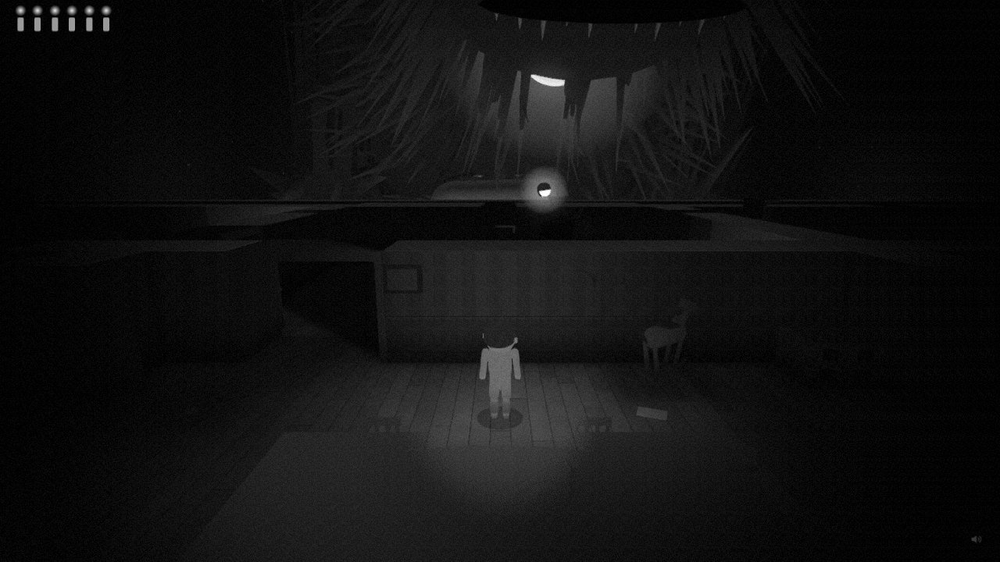
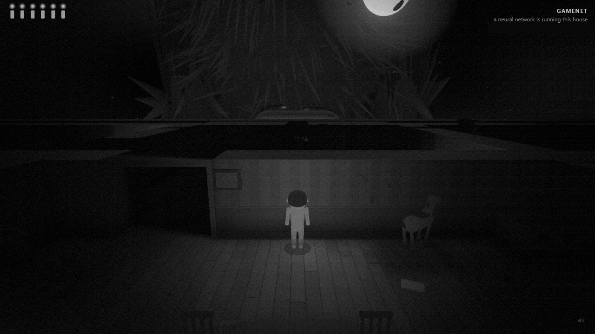
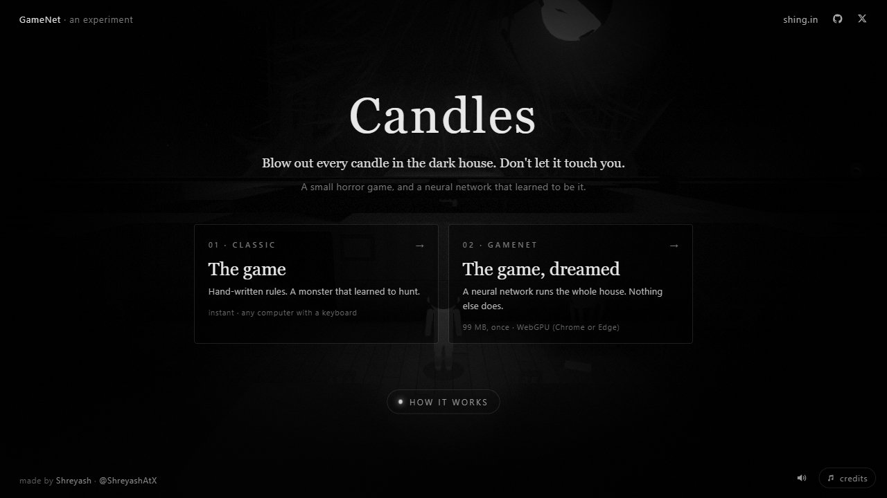
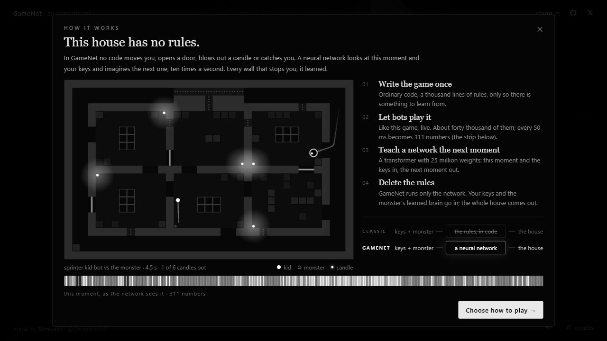
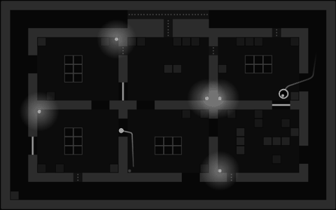

<div align="center">

# Candles

**A small horror game, and a neural network that learned to be it.**

**[Play at candles.shing.in](https://candles.shing.in)** · made by [Shreyash](https://shing.in) · [@ShreyashAtX](https://x.com/ShreyashAtX)


</div>

## The idea

You are a small kid in a dark house. Blow out the candle in every room. Something lives here: it is faster than you, it
hears you run, and across the table a giant is playing it with a controller, a searchlight and, when it gets impatient,
its hand.

That is the game. The experiment, **GameNet**, asks whether a neural network can *be* that game.

**In GameNet there are no rules.** No code moves you, stops you at a wall, opens a door, blows out a candle or decides
that you were caught. A transformer looks at this moment of the house and the keys you press, and imagines the next tenth
of a second, ten times a second, in your browser. Every wall that stops you is a wall it learned. When it slips, the house
slips with it.

The game was written once, as ordinary code, only to have something to learn from. Bots played it about forty thousand
times. The network learned from those games, and then the rules were deleted.

| | What runs the house | Needs |
|---|---|---|
| **Classic** | The rules, about a thousand lines of code | any computer with a keyboard |
| **GameNet** | A neural network with 25 million weights, and nothing else | WebGPU (Chrome or Edge on a computer), a 99 MB download once |

In both, the monster is the **nightmare**:
- a small network that learned to hunt by playing bots;
- it catches 97.5% of them;
- it reaches under beds and into cracks, and squeezes into the vents after you, slower than you crawl.

Winning is rare. That is intended.

<table>
<tr>
<td width="50%"><br><sub><b>Classic.</b> The giant leans over the board; the monster's eye shows over the wall.</sub></td>
<td width="50%"><br><sub><b>GameNet.</b> The same house, but every frame is the network's guess.</sub></td>
</tr>
<tr>
<td width="50%"><br><sub>The first screen: two ways to play.</sub></td>
<td width="50%"><br><sub>"How it works" on the site: a live bot game and the numbers the network sees.</sub></td>
</tr>
</table>

## How GameNet works



1. **Write the game once.** The rules (`game/src/sim`) run headless in Node. Every 50 ms of a game becomes a row of 311
   numbers: the kid, the monster and its mind, candles, doors, toys, the searchlight, the hand. Both players' inputs
   are saved with it.
2. **Let bots play it.** Kid bots of five styles and varied skill play the monster: 30,000 games, plus 8,000 drills
   for the rare moments (crawl spaces, the giant's tools). *Right: one of those games.*
3. **Teach a network the next moment.** A transformer (384 wide, 12 layers, `game/train`) reads the row in pieces and
   the house's tiles, and predicts the next row from the two players' inputs. It is trained first on the recorded
   games, then on its own output, so it stays stable when it is left to run alone.
4. **Teach a monster to hunt.** The nightmare (`game/src/sim/mind/nightmare.js`, `game/train/rl`) is a 2 × 256 policy
   trained with PPO against a league of kid bots. Every 0.25 s it picks a goal: the kid, a cut-off, a guess, a noise,
   a candle to guard, a wardrobe.
5. **Delete the rules.** In GameNet the world model is the house. The nightmare reads what its monster sees, hears and
   feels from the model's own output, and presses the monster's buttons. Those buttons go into the model just as your
   keys do. It runs with ONNX Runtime Web on WebGPU in a worker (`game/src/model`). A light decoding layer refuses
   only what the model's own world contradicts, such as a catch with nobody near or a candle relighting.

<br clear="right">

### Where it stands

Measured with bot exams inside the model. The full log, run by run, is in
[the training spec](docs/superpowers/specs/2026-10-11-gamenet-training-spec.md).

- **The mechanics exam:** 384 generated moments (every candle, door, wardrobe, toy, crawl space, the searchlight
  and the hand), each run 3 times. The play model, `v5_M_s2u`, passes 303 of them every time.
- **The hunt:** inside the model, the nightmare catches 35 of 40 bot kids.
- **Speed:** on an Intel Iris Xe laptop it runs at about three-quarters of real time.
- **Weak spots:** inside the model the searchlight and the hand often miss what the rules would do, and now and then
  the house slips.
- **Cost:** all the training took about $17 of rented RTX 4090 time.

## Controls

| | |
|---|---|
| WASD / arrows / stick | run |
| Shift | creep, quietly |
| E or Space (hold) | blow out a candle |
| E or Space (tap) | open and shut doors, hide in and leave wardrobes |
| Q | throw the toy you carry (it makes a noise where it lands) |
| mouse wheel | camera closer / further |
| Esc | pause, and the menu |
| M / H | sound / hints |

## For developers

### Run it

```
cd game
npm install
npm run dev        # http://localhost:5190
```

`npm run build` writes `game/dist` (about 134 MB): the game, the audio, the play model and the runtime's files.

### Deploy

`game/dist` is static. The host must send two headers so the runtime can use threads:

```
Cross-Origin-Opener-Policy: same-origin
Cross-Origin-Embedder-Policy: require-corp
```

- **Vercel:** import the repo with **Root Directory `game`**. `game/vercel.json` sets the build, the headers and the
  caching.
- **Other hosts:** set the same two headers.
- **File sizes:** the largest file is the runtime's WebAssembly (26.8 MB). Cloudflare Pages caps files at 25 MiB, so
  use Vercel or Netlify, or another host without that cap.
- **The model:** it ships as `game/public/models/v5_M_s2u/play.json` plus four 24 MB parts
  (`node tools/ship_model.mjs NAME` makes them from a trained `packed_brain.onnx`). The browser keeps the parts by
  their md5, so a return visit skips the download.
- **Models hosted elsewhere:** build with `VITE_MODEL_BASE=https://…/models/`. That host must allow CORS.

### Repository

```
game/
  index.html, src/main.js     the site: first screen, the two modes, the game loop
  src/sim/                    the rules, no graphics (runs in Node): rules.js has every number, level.js the house
    mind/                     the monster minds: five coded personas, the learned nightmare
    bots/                     kid bots and mid-game starts
  src/render/, src/audio.js   three.js view, sound
  src/model/                  GameNet in the browser: worker.js (the model), brain.js (the nightmare inside it),
                              decode.js / layout.js (the row in and out), dream.js (the game side)
  train/                      the world model (model.py, train.py, data.py, export.py), RL (rl/), pod scripts (pod/)
  tools/                      data (gen.mjs, coverage.mjs), exams (dream_exam.mjs, mechanics/), sim.mjs, check.mjs,
                              ship_model.mjs, clips/ (videos of games)
  test/                       519 tests: every rule's scenario, the minds, the schema, the generator
  dream.html, review.html     research pages for local use: the models' videos and exams, and clips of what the
                              model learns from (their videos and the research models are not committed)
docs/
  design.md                   the game's design and the reasoning behind each mechanic
  mechanics.md                every rule as a case, each with a scenario in game/test/scenarios.test.mjs
  superpowers/specs/          the training design and the full training log, run by run
```

The earlier prototypes (forest, school, The Long Way Home) are kept under the git tag `archive/before-maze`.

### Tests and tools

```
cd game
npm test                         # 519 tests, about 10 s
SLOW=1 npm test                  # also plays 20 games per kid style (about 3 minutes)
npm run check                    # the house: every candle reachable, starts far apart, what each crawl passage saves
node tools/sim.mjs 60 1          # balance probe; env PERSONA=nightmare KID=sneaker SKILL=0.6 START=fresh
```

Dev links (they skip the first screen):
- `?persona=stalker|brute|hound|warden|pathfinder|classic|nightmare` picks the monster in the rules game.
- `?model=NAME` plays any model in `public/models`, and `&debug` shows its numbers.
- `?watch=v5:12` replays game 12 of batch v5 exactly, as the generator played it, with no data needed (`[` `]` change
  the speed).

### Making data and training

```
cd game
node tools/gen.mjs v5 3600       # bots play; writes data/v5/ at the repo root (see below)
node tools/coverage.mjs v5       # how often each rule happened; outcomes by monster, kid and start
```

`data/<batch>/shard-NNN/` holds:
- `episodes.jsonl`: one line per game: config, outcome, rule counts, row offsets;
- `states.f32`: the rows, `rows + 1` per game;
- `ki.f32` and `gi.f32`: the kid's and the giant's inputs;
- `events.jsonl`: every event with who and why.

`schema.json` describes the row.

```python
import json, numpy as np
d = 'data/v5'
s = json.load(open(f'{d}/schema.json'))
X = np.fromfile(f'{d}/shard-000/states.f32', np.float32).reshape(-1, s['stateSize'])
eps = [json.loads(l) for l in open(f'{d}/shard-000/episodes.jsonl')]
```

The exams (`tools/dream_exam.mjs`, `tools/mechanics/exam.mjs`, `--brain`) read a whole `packed_brain.onnx`; a clone
has the play model only in parts: `cat game/public/models/v5_M_s2u/packed_brain.onnx.{0,1,2,3} > game/public/models/v5_M_s2u/packed_brain.onnx`.

Training ran on rented GPUs with the scripts in `game/train/pod/` (`v5_run.sh` makes data v5 and trains the world;
`rl_v5.sh` trains the nightmare; `v4_exams.sh` runs both exams). `train/export.py` writes the ONNX graphs the browser
runs. The spec has every run, its numbers and its cost.

## Credits

Made by [Shreyash](https://shing.in) ([@ShreyashAtX](https://x.com/ShreyashAtX)).

Music by Kevin MacLeod (incompetech.com), licensed under [CC BY 4.0](https://creativecommons.org/licenses/by/4.0/):
"Ossuary 6 - Air", "Spider Eyes", "SCP-x4x (Mind Leech)". Sounds from BigSoundBank, OpenGameArt and an 1890 Edison
talking doll (CC0 and public domain); every file and its source is listed in
[game/public/audio/CREDITS.md](game/public/audio/CREDITS.md).
