# 00 — Design (living document)

> **2026-10-08: a proposed pivot to a school setting (brutal horror, a story to uncover) is in [`02_the_school.md`](02_the_school.md). Under discussion. The forest below is built and stays as it is.**

Status: **concept stage**. Nothing below is built. Each section is marked **Decided**, **Proposed** (my suggestion, not yet agreed) or **Open**.

## 1. The idea in one paragraph

Instead of building a game out of mechanics + player controls + assets, the game *is* a small set of neural models running in a closed loop, taking player input when there is any. We don't teach the models "a game". We teach them a set of simple probabilistic rules (how the boy moves, how trees grow, how the entity behaves) by distilling a procedural rule-world. Wherever the models fall short of the rules, the world drifts. In this experience, drift is meant to happen: it is the dream-horror.

## 2. Intent

**Said by the user:**
- An *experience* more than a game. Free, infinite, open world.
- A research project as well: keep every asset, result and note (the Brushwork project's way of working).
- Small, fast models; hand-made assets stay non-neural.
- Hallucination is a feature, not a bug. A model that learns ~70% of the rules leaves ~30% "smooth dream-state horror".
- Training data comes from a procedural rule-world: simple rules with probabilities, run by random/scripted/RL agents.

**Assumed (please correct):**
- Single player, runs locally on a laptop-class machine.
- Success for v1 = a playable vertical slice that feels like the story, plus a measured answer to "does model error read as horror or as mush?"

## 3. Story and look — Decided

- **World:** grey oil paint. Trees, leaves, creatures, all in visible brushstrokes. No colour.
- **The boy:** searching for the world's lost happiness.
- **The colour field:** a field of colour (flowers etc.) he chases. It appears in glimpses and dissolves into hallucination. He can never reach it.
- **The entity:** utterly dark and evil, lurking around. It keeps appearing and interacting beyond the main journey.
- **Dialogue:** short lines at the bottom of the screen carry the story.

## 3a. Perspective — Decided

**First-person, 2.5D: the world looks 2D, feels 3D.** Hand-painted flat cards (trees, leaves, creatures, the entity) stand in 3D space and turn to face the camera, like the sprites in Doom or a paper theatre / pop-up book. Walking gives real depth and parallax, and every object stays a flat oil painting.

Why it fits:
- **The data layer stays the same.** World state is a flat 2D map (positions, headings, card types), as in Doom. First-person is only how the renderer projects it. The models stay small; visuals can change later without retraining the world.
- **The horizon still works.** The colour field is a distant card or band that recedes as you approach.
- **Built-in uncanny:** cards always face you, so the entity is always looking at you. Hallucination shows up as cards popping in, swapping or bending.

## 3b. Session shape — Decided

**A loose playthrough inside an infinite world.** It's an experience, not a story game: a session escalates (calm → glimpses → the entity's ladder climbs), with no authored ending required. Endings and deep narrative are explicitly *not* a focus (user, 2026-10-07).

How we keep the escalation consistent without asking the neural models for it (Proposed): a small **story director** holds the precise, discrete facts (chapter, escalation stage, beats already fired). It is a library of authored behaviour examples; the models *pick and perform* them. The models only need local consistency (this tree, this minute); the director carries the long-range thread. This is the user's "build behaviour examples and the model picks".

## 3b-ii. Meaning — Decided: author knows, player derives

**Nothing is said outright.** The player derives whatever they want; explaining is not our concern.

We still keep a private **story bible** (never shown) so that every clue points the same way; ambiguity with no truth behind it reads as noise. The bible's truth: *the entity is the lost happiness gone wrong* (the boy's grief given a body). Friendly waving side = the memory of what it was; melting side = what it became; the colour drips out of it; the field is unreachable because he is chasing the wrong thing.

Rules that follow:
- Dialogue never explains. It only says what the boy feels or notices.
- Meaning is carried by images and behaviour (colour dripping, the wave, the field dissolving at his fingertips).
- No text, item or cutscene confirms the bible.

## 3c. Concept sketch 1 — hands, entity, forest

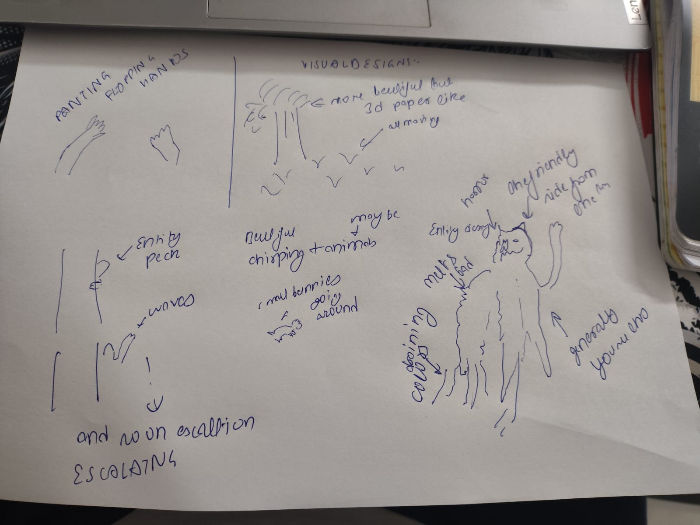 (raw photo: `img/01_concepts_hands_entity_raw.png`)

- **Painted floppy hands:** the boy's hands, loose and painterly, reaching.
- **Entity escalation ladder:** peeks from behind a trunk → waves → "!" → … escalating.
- **Forest:** more beautiful trees, 3D paper-like, everything moving; leaves drifting.
- **Life:** beautiful chirping, animals, small bunnies running around. The grey world is alive, not dead.
- **Entity design:** tall, cat-eared head, a smile (labelled "horror"). One friendly side with a waving hand; the other side melts ("melts bad"), with **colour dripping** from it. One label near the body isn't legible yet ("generally you…").

## 3d. Concept sheet v1 (2026-10-07) — for review

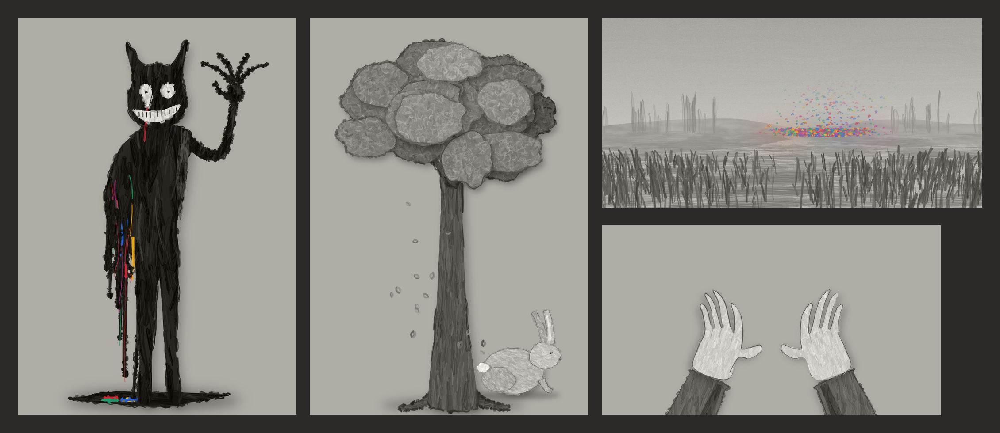

Clean versions of sketch 1, painted procedurally by `spike/concepts/` (throwaway brush engine: bristle strokes, dab fills, ragged edges, cut-paper shadows). Cards saved as transparent PNGs in `assets/art/` (entity, hands, tree, bunny, colour_field). Re-render: `python spike/concepts/serve.py` → `localhost:5180` (`?only=<name>` for one card, "Save all" writes `assets/art/`).

## 3e. Look v2: pinned paper — Decided (2026-10-07)

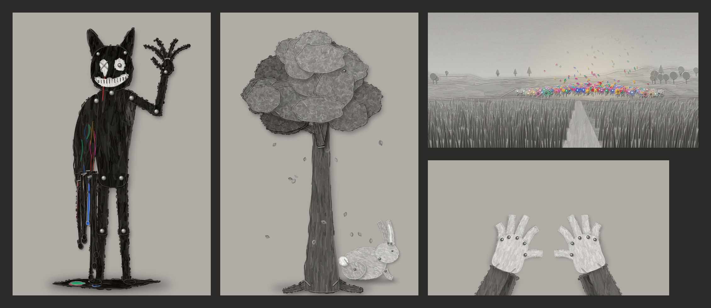

- **Everything is a cut-paper puppet**, painted in grey oil: parts are separate paper pieces with cast shadows and paper edges.
- **Joints are split pins (paper fasteners); attachments are staples.** Tree branches are stapled to trunks and leaf clumps pinned or stapled on. The entity is pinned at neck, shoulders, elbow, wrist, knuckles, hips and knees; its drip strips are stapled to the melting side; its ears are pinned on.
- **The entity's eyes:** one stapled on (an X of staples, the eye that runs red), one with a split pin for a pupil.
- **The boy's fingers are paper strips pinned at the knuckles**, which is why they flop.
- **The colour field is a paper diorama:** layered grey paper hills, cut-paper grass blades, a trodden path, and a mound of coloured paper flowers (rosettes, tulips, daisies; the big ones pinned through the centre) whose petals come loose and fade to grey as they rise. The user approved this flower and field design.

**Every pin and staple is where dynamic action happens** (user). Pins are the rig: each one is a pivot with an angle. That is the state the models drive (§4): a puppet's pose = its pin angles, so the data layer for "how the entity moves" is a short vector of joint angles, not pixels.

## 3f. The core moment: following the petals — Decided (2026-10-07)

You walk through the paper forest and fields. In the distance, stray petals drift past: never a whole field, just loose petals here and there. You keep following them, and then suddenly, right there, is the field. (Then it dissolves; §5.2.)

Petals are the breadcrumbs: they are how the world pulls the player along without UI, and they are the thing the colour-field model emits most often. (§3g replaced the hidden "target" with the petal loop: the field is now a probability you raise by collecting petals.)

## 3g. Mechanics v1: the petal loop — Decided and built (2026-10-07)

Built in `spike/walk/` (see its README). **Every number lives in `spike/walk/src/rules.js`**: that file is the rulebook the models will learn.

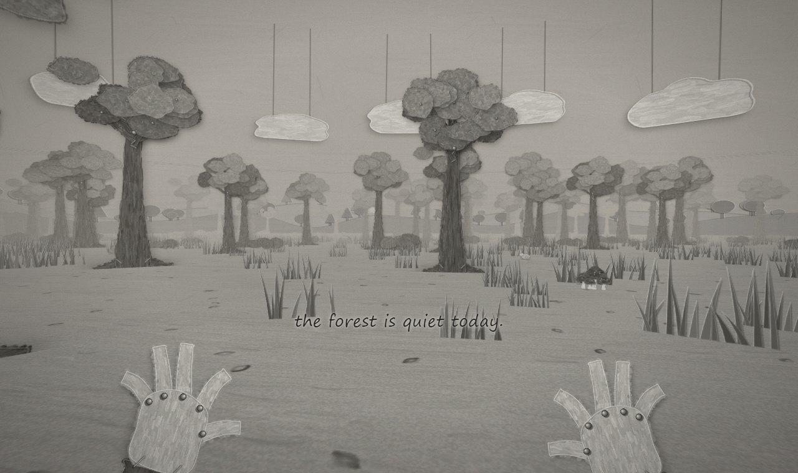

**The loop**
1. **Catch petals.** Stray coloured petals drift through the grey forest, one at a time, never a field. Walk into one, or hold reach, to catch it. It gets **pinned to the back of your left hand**, so a paper flower grows there as you collect (max 12). There's no HUD.
2. **The field gets likelier.** With 3 or more petals held, the field has a per-second chance to bloom, rising with every petal up to a cap (`bloom.hazard*`). It pops up right in front of you, and **your petals fly off your hand back into it**.
3. **A small chance to reach it.** Walking into it (or reaching for it) rolls once: `3%` per petal you gave, capped at `35%`. Fail and it comes apart at your fingertips. Succeed and **colour floods the whole grey world**, then an ending card appears ("for a moment, everything was colour.") and you keep walking.

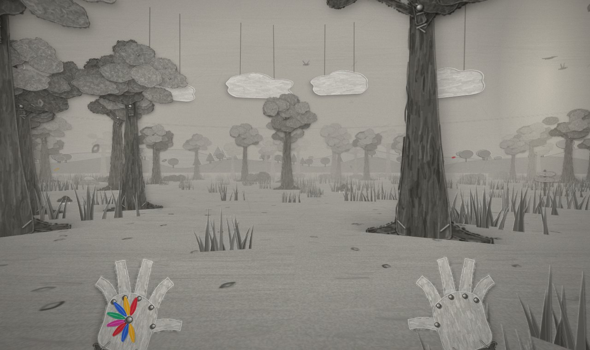 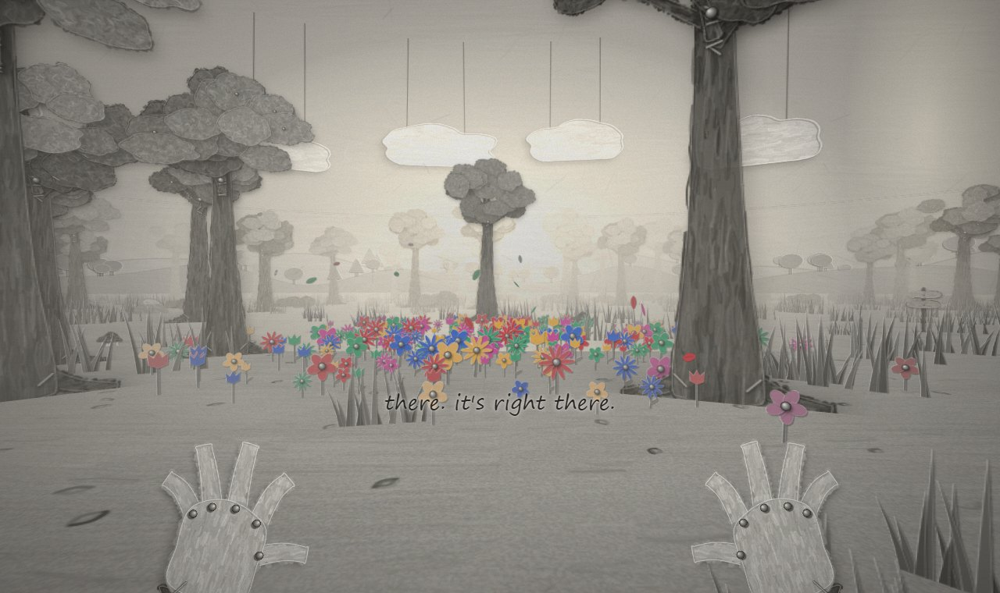 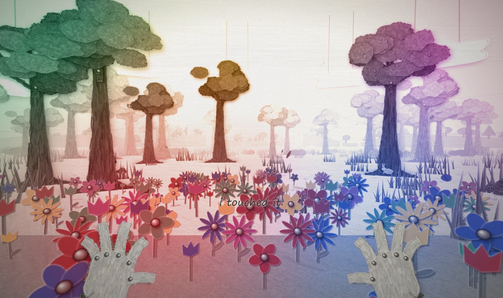

**The entity v2: a double-sided paper card**
- **Front:** the smiling, waving side. **Back:** the other side, shown mirrored when the card flips: ears drooping, both eyes running colour, a frown stapled shut.
- **Peek:** it peeks from behind a trunk. Each time you notice it, it leans out further (`exposure`).
- **Turn:** after 3 or more noticed peeks it may stop hiding. It steps out and **the card flips over** to its sad side.
- **Hunt:** it then comes for you in random stop-motion lunges, mostly while you're not looking, limbs thrown into new poses on their pins. It leaves an ink trail with flecks of stolen colour. It sometimes darts behind a tree first. It gives up if you get far enough away.
- **Escape by giving it something:** let a petal go (right-click / Q). It goes to the petal instead, **flips back to its smiling side and stands over it, head tilting one way then the other**, as if trying to remember that version of the world. The colour in its melt pulses. Then it's gone.
- **Caught:** the screen crumples like a paper ball and goes dark. You wake somewhere else in the forest, your hand empty.
- **Its effects:** torn dark paper creeps in from the screen edges, the fog darkens and closes in, a low drone rises, the birds go silent, the camera trembles when it's near, bunnies bolt, the empty swing swings harder.
- The old rungs remain: **wave** from the open, and **standing behind you**.

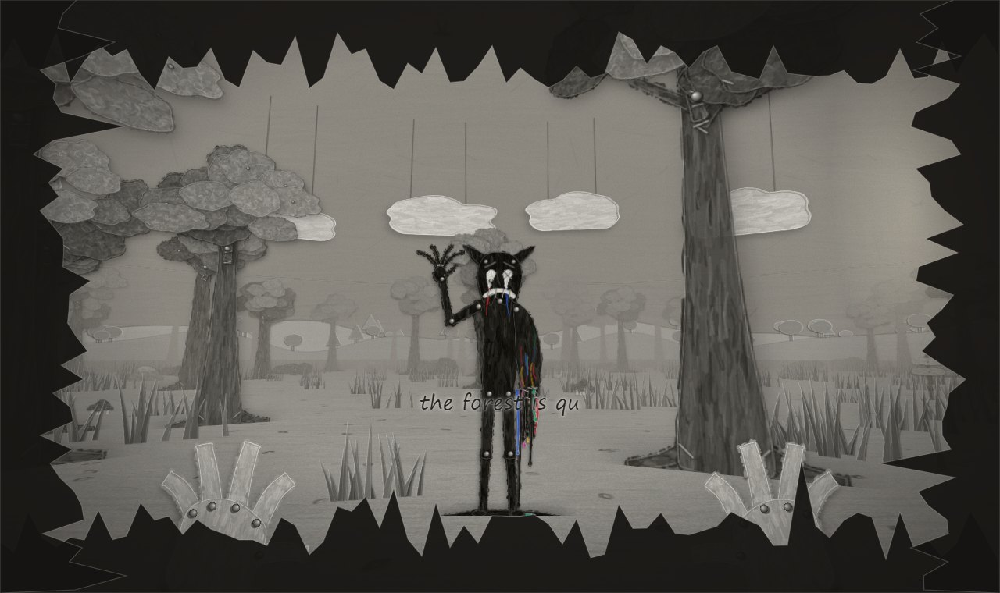 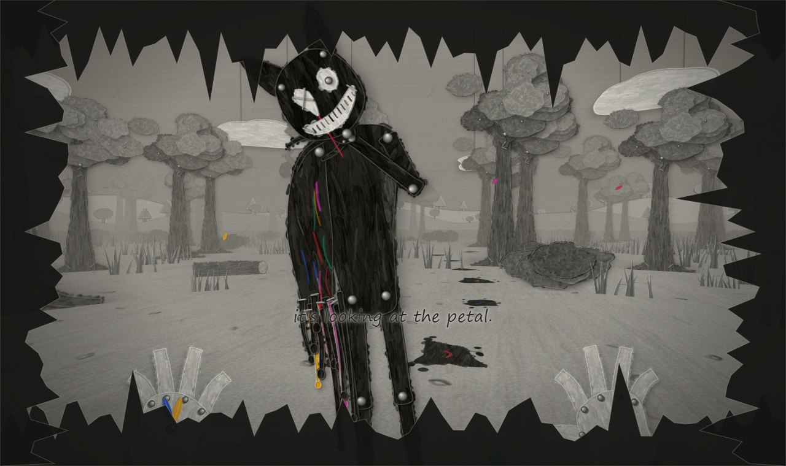 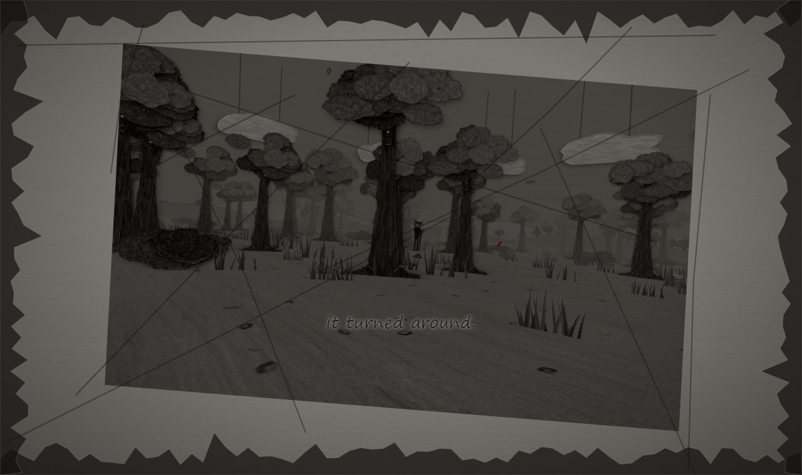

**Fog:** banks of paper mist drift through the trees all the time. Every 1–2 minutes a mist event rolls in for 25–50 s and visibility drops to a few trees. The entity comes back sooner in the mist.

**Less empty:** chunks are now **groves** (dense), **clearings** (open, each with one small scene and a shaft of light: a pond, a bench, a blank signpost, or a swing that swings with no one on it) or ordinary forest. Stumps, logs, rocks and mushroom clusters sit in between.

**Hands:** full hands with sleeves at rest. They swing when walking, **pump when sprinting** (Shift, with a wider field of view), and stretch forward to reach. Fingers flop on their knuckle pins.

**Sound:** a generated set in `assets/audio/` (two crossfading music beds, calm and dread, plus paper ambience and SFX; all original, see `assets/audio/README.md`). Every sound also has a synthesised fallback.

## 4. Architecture (from the napkin) — Proposed

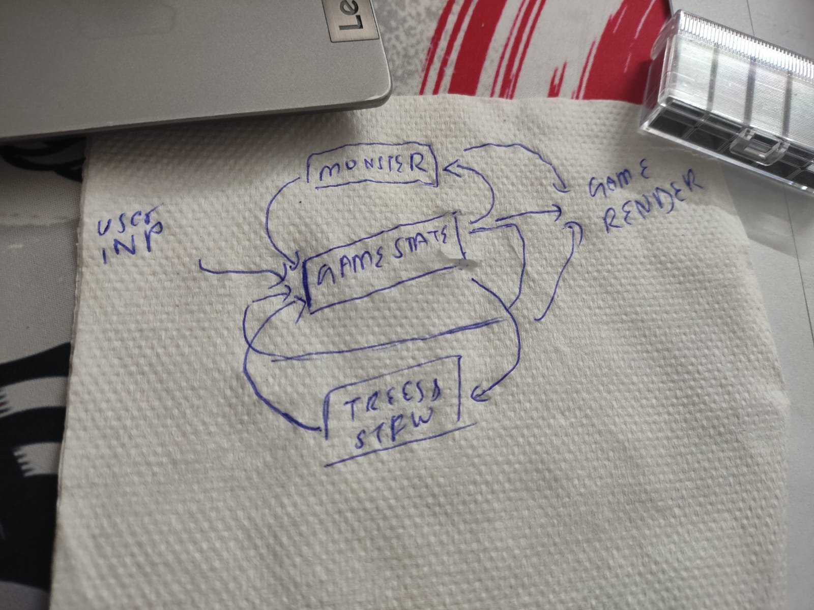

```
user input ──► GAME STATE ◄──► ENTITY model
                   ▲  ◄──► SCENERY / TREES models
                   └────────► RENDER ──► screen (+ music model, later)
```

- **Game state hub:** a small structured part (boy position/pose, entity position, time, "dread", glimpses so far) plus an optional learned latent.
- **Per-thing looped models:** each trained on its own rule set; each reads and writes the hub.
- **Renderer:** reads state only. v0 uses hand-made assets; later possibly a stroke model (Brushwork) so the paint itself can drift.

## 5. Principles we've agreed on or proposed

1. **Every model samples; none regress to the mean.** (Proposed.) Averaging models fail as mush (a frozen entity, stiff limbs, blur). Sampling models fail as plausible-but-wrong choices, which is the horror we want. Brushwork measured this: per-number MSE/tokens failed, diffusion over whole strokes worked.
2. **Colour is held loosely on purpose.** (Proposed.) Training data is grey. Colour enters only as a weak, high-temperature condition that fades as the boy gets closer, so the field dissolves for real, without a script.
3. **The entity as absence.** (Proposed.) Pure black or erased paint in a grey world; hallucinated edges make it worse in a good way.
4. **World is generated, story beats are authored.** (Proposed.) The state tracks chases, entity closeness and time since last glimpse; that decides when the next authored beat fires.
5. **Dialogue is hand-written.** (Proposed.) A model may choose and order fragments; it never writes them.
6. **Train on own rollouts.** (Proposed.) Models trained alone then wired together see each other's errors for the first time; train on noisy rollouts and fine-tune jointly.

## 6. Research question — Proposed

Does a world model distilled from a set of simple, separate probabilistic rules (a) produce new combinations it never saw, and (b) make errors that are aesthetically usable (uncanny) rather than degenerate (mush)? Measure: rule-violation rate vs human-rated creepiness, with a "dream" knob.

## 7. Open decisions (we go through these one at a time)

**Experience**
- [x] Camera/perspective → first-person 2.5D painted cards (§3a)
- [x] Who the player is → **you are the boy, glimpsed**: small painted hands reach out near the colour field; shadow, feet when looking down, reflection in water. Dialogue is his inner voice.
- [x] Session shape → loose escalating playthrough in an infinite world, no required ending; director holds long-range facts (§3b)
- [x] What the entity *is* → hidden truth B (grief / happiness gone wrong), never stated; player derives (§3b-ii)
- [x] Ending → not a focus; none required
- [x] Verbs → walk, sprint, look, reach (catch petals, reach the field), let a petal go (§3g)
- [x] Entity ladder → peek (leaning out more) → turn → hunt; wave; behind; petal → remember (§3g)
- [x] Dialogue voice → short inner-voice lines tied to events (`spike/walk/src/dialogue.js`)

**Mechanics (rules + probabilities)** (v1 built, all numbers in `spike/walk/src/rules.js`)
- [x] Boy movement set
- [x] Forest/scenery generation rules (biomes, props, clearings)
- [x] Entity behaviour rules
- [x] Colour-field rules (petal loop)
- [x] Dread / pacing state (`S.dread`, mist events, entity escalation)
- [ ] **Next (with the user):** the data twin (`research/01_data_twin.md`), then the engine that combines game state + per-entity behaviours

**Gameplay data**
- [ ] Rule-world simulator (language, 2D/3D)
- [ ] Agents that generate play (random / scripted / RL)
- [ ] State format

**Models**
- [ ] State-model architecture + sampling head
- [ ] Renderer (assets first, Brushwork later?)
- [ ] Music model (parked)

## 8. Prior work to survey (→ `01_prior_work.md`)

World models: World Models (Ha & Schmidhuber 2018), GameGAN, GameNGen, DIAMOND, Oasis, Genie 2/3, Muse/WHAM. Experience games: Journey, Limbo, Inside, Gris, Little Nightmares.
