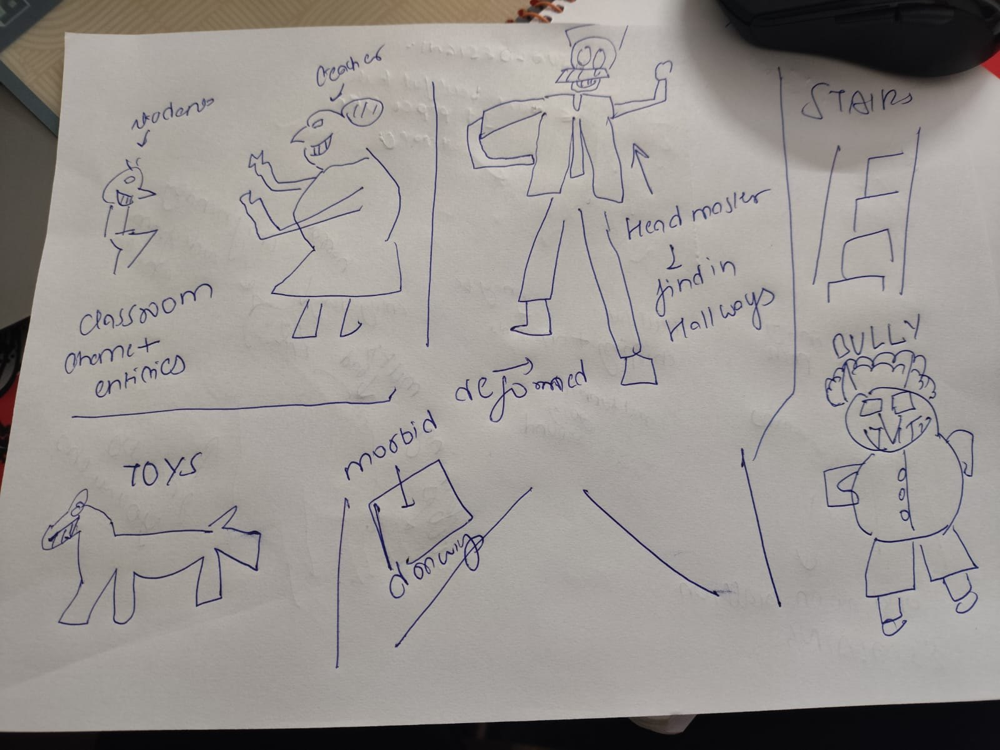
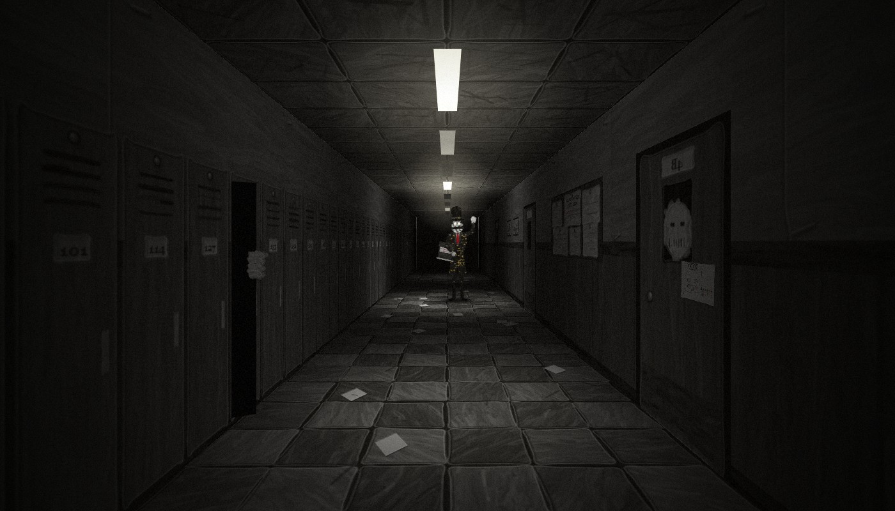
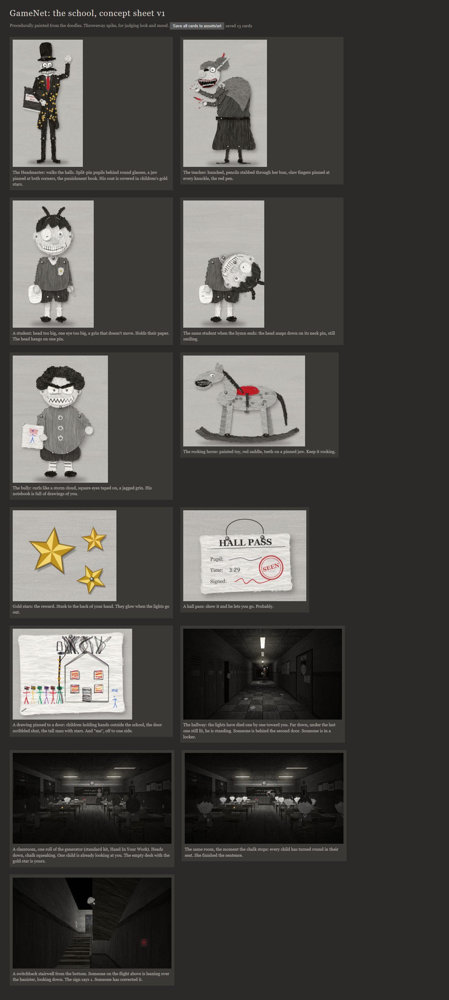
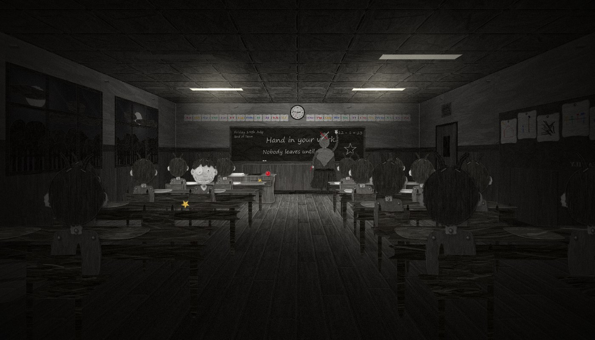
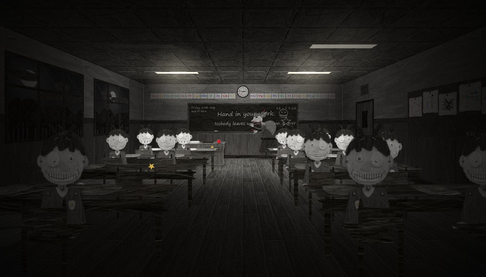
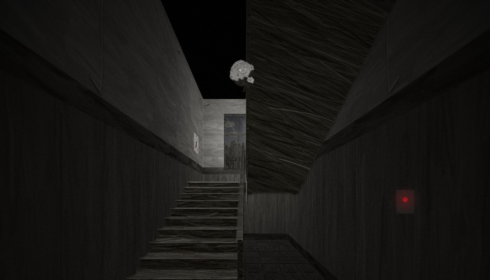

# 02 — The School (design draft for discussion)

Status: **Proposed, 2026-10-08.** This is a first draft for us to discuss, built from the user's second sketch (`img/04_sketch_school.jpg`) and their pitch. Nothing here is built. The forest prototype in `spike/walk/` stays as it is. Every section is something to argue with.



## 0. What the user asked for (their words, condensed)

- Swap the forest for a **school**. Procedurally generate the classrooms, hallways and stairs. There should be only a **very, very rare chance of getting out**.
- Creepy classrooms, music rooms with a **choir**, students doing homework, scary teachers. *"A dimly lit hallway is always really scary."*
- **More to do, and more danger while you do it.** *"Almost all other games, you are doing something and some danger is there; here it's not there as much."*
- **Situations spawn at random**:
  - **Classroom:** collect every student's paper and put it on the teacher's desk before the choir ends. Fail, and every student stands, smiles, and their heads snap downward while the teacher shouts. The end.
  - **Hallway:** the Headmaster finds you. Get into a room in time, or show a **hall pass** earned in a classroom.
  - **Toy room:** put all the balls in place before the rocking horse stops rocking, or it morphs into something real.
  - Plus the bully, the stairs, and morbid, deformed drawings.
- **Go all out on horror.** Things that make you jump, in every way. Brutal.
- **A story:** slowly learn what happened, and leave this horror house.
- The same shape as the petal loop: **doing more makes things worse, but makes the exit likelier.**

## 0b. First look (concept sheet v1, 2026-10-08)



**The hallway mood frame** is drawn the way the game would draw it:
- Every surface is a painted paper texture (stapled wall sheets, a bank of pinned lockers, crooked paper floor tiles, classroom doors). Each one is mapped into perspective a screen column or row at a time, like Doom.
- Ceiling tubes then light it, as pools of light straight down.
- The lights have died one by one toward you. Far down, under the one still on, **the Headmaster** is standing, his glasses catching the light.
- A face is pressed to the window of door 4B, with a crayon drawing pinned below it.
- A locker stands open a crack, with fingers round its edge.
- On the noticeboard: *End of Term Concert — doors will be locked.*



Scene frames (hallway, classroom, stairwell) are kept only as JPGs in `research/img/`; the PNG cards in `assets/art/school/` are the reusable pieces.

**The cast** is the same pinned-paper language as the forest. Every grey pin is a joint the game animates. Transparent cards are in `assets/art/school/`. Re-render with `python spike/concepts/serve.py`, then open `localhost:5180/?set=school`. The code is `spike/concepts/school.js`.

| Card | What it is |
|---|---|
| **Headmaster** | Tall hat, round glasses with split-pin pupils, a moustache wider than his face, a jaw pinned at both corners, a red tie. Holds the punishment book and raises a fist. **His coat is covered in children's gold stars.** |
| **Teacher** | Hunched, her neck thrust forward. Pencils stabbed through her bun, a monocle on a chain. A mouth that opens too far, lined in red, with two rows of sharp teeth. Claw fingers pinned at every knuckle, red nails, the red pen. |
| **Student** | Head too big, one eye too big, a pointed nose, a fixed grin. Holds their paper. The head hangs on one neck pin. **Snapped:** the same student when the hymn ends. |
| **Bully** | Storm-cloud curls, square eyes taped on, a jagged grin, button pins. His notebook has a crayon drawing of you, scribbled over in red. |
| **Rocking horse** | Painted dapples, a red saddle, stapled paper mane and tail, an open mouth of teeth on a pinned jaw. |
| **Gold stars, hall pass** | The pass is stamped SEEN in red, time 3:29. |
| **The drawing** | Children holding hands with their faces scribbled out. The school with fire in every window and the door scribbled shut. The tall man with stars down his coat. *"me"*, small and blue, off to one side. |

## 1. Pillars

1. **Horror made of rules.** Every room teaches a rule (*while the chalk squeaks, she can't see you*), and the horror is the rule breaking. This is the GameNet thesis turned into gameplay. The rules are the game, the models learn them, and when a model learns a rule slightly wrong the school breaks a rule you trusted. Dream errors become scares, not mush.
2. **Always a task, always a threat.** You're never just walking. There's a job in front of you (papers, balls, a song) and a clock you can hear (a hymn, a creak, a chalk squeak). Something is coming down the hall.
3. **The school notices you.** Every gold star you earn brings the exit closer *and* makes the school pay more attention to you.
4. **A paper school.** It's the same craft language as the forest: grey oil paint on cut paper, split pins at every joint, staples, sticky tape. A child's diorama of a school. Only three colours exist:
   - **gold** (star stickers, the reward)
   - **red** (marking pen, the teachers, danger)
   - **crayon** (the boy's drawings, memory, the story)
5. **The story is told through things, never text dumps.** Torn pages, the register, class photos, notices, the hymn.

## 2. The fantasy

You're the boy. You fell asleep at your desk. The last bell rang and nobody woke you. Now it's dark, but the school is still **in session**: every room is mid-lesson, the hymn plays over the speakers, and the Headmaster walks the halls. You want to go home. It is never quite home time.

**Working title: HOME TIME.**

## 3. The loop

```
explore (procedural halls, stairs, rooms)
   └─► a room is IN SESSION: a task + a clock + a rule
          ├─ succeed ─► GOLD STAR stuck on the back of your hand (sometimes a HALL PASS or a TORN PAGE)
          │               ├─► exit likelier (the front doors may appear on the ground floor)
          │               └─► ATTENTION rises (the clock jumps forward, the halls get worse)
          └─ fail ─────► the room's DOOM (big scare) ─► EXPELLED
   hallway threats on the way: Headmaster, bully, the 13th step ─► CAUGHT ─► DETENTION
```

This maps one-to-one onto the forest build. Petals become **gold stars**, pinned to the same back of the left hand, max 12. The colour field becomes **the front doors**. The entity becomes the **Headmaster** (plus a cast). Mist becomes the **global events** (lights out, fire drill, roll call). Crumple-and-wake becomes **detention**.

### 3.1 Stars and the exit
- **Exit hazard.** With 3 or more stars, each new stretch of ground-floor main corridor has a chance to end in **the front entrance**: `min(cap, base + perStar·n)`. You learn to go downstairs when you're "rich".
- **The reach roll.** Walking up to the doors makes one draw, at **3% per star, capped at 35%**, the same numbers as the field:
  - **Fail:** the doors open onto *another hallway*. It's the same one you started in, and the photos are more scratched. Your stars peel off your hand and flutter into the dark.
  - **Succeed:** daylight, colour floods in, and you walk out into the **paper forest** (§8).
- **Drop a star (Q / right-click)** to buy time:
  - The **Headmaster** stoops, picks it up, studies it and pins it to his coat. His coat is covered in hundreds of children's gold stars.
  - The **bully** takes it and lets you pass.
- **Lights out:** the stars glow faintly on your hand. They're your only light, and they make you **visible**. The richer you are, the brighter you shine.

### 3.2 Attention: the clock
Every wall clock in the school shows the same time, which is the night's progress toward **3:30, home time**. The clock moves slowly by itself and **jumps with every star, every noise and every time you're seen**. It is the diegetic attention meter: no HUD, you read it off the walls. As it climbs:

| Time | What changes |
|---|---|
| ~1:00 | Normal lessons. The Headmaster patrols rarely. Rooms are forgiving. |
| ~2:00 | Patrols get frequent. Hymns get shorter. Wrong variants start appearing (an extra student, a door that wasn't there). |
| ~3:00 | Lights fail. The bully roams. Rooms get harsher. The class photos have nearly every face scratched out. |
| **3:30** | **THE FINAL BELL.** It rings and doesn't stop. Every door opens and everything hunts you. The exit is at its most likely. Survive to the doors, or the night ends. |

This gives every night (one run) a shape: about 25–40 minutes, a slow build, then a final chase.

### 3.3 Two kinds of failure — Decided (A, 2026-10-08)
- **CAUGHT** (the Headmaster, the bully, small mistakes): the screen crumples and you wake in **DETENTION**.
  - You've lost your stars, and the clock jumps forward.
  - Detention is a scene, not a menu. You must write *I will not leave* on the blackboard (hold E, chalk squeaks) while the Headmaster dozes at his desk. When the snoring stops, you freeze. After the lines, he unlocks the door: *"Run along."*
- **EXPELLED** (a room's doom, or caught after the final bell): the room's horror finale plays in full, and **the night is over**. You keep the torn pages you found, so the story persists across nights (roguelite). The next night is a new school from a new seed.

## 4. The school is decks, not levels

### 4.0 Every area is a deck (user, 2026-10-08: "every area should have huge areas of expansion", "should not feel boring and monotone")

Every kind of space is built from the same five layers, each one a deck of cards in the rulebook:

| Layer | What it is | Example (classroom) |
|---|---|---|
| **Kit** | the physical space: shape, size, exits, furniture | a long room, 4×6 desks, windows on the left, a door at the back |
| **Activity** | what's happening in it right now: the task, clock, rule and doom | *Minute's Silence* |
| **Who** | who runs it or patrols it | a substitute teacher |
| **Twists** | 0–3 modifiers that bend the rules or the picture | an extra student; lights out |
| **Valuables** | what's worth taking, and what it costs to take | the teacher's drawer, your desk, the coat pegs |

On top of that, **ambient life** runs everywhere: small behaviours with no rule attached. A pencil scratches. A child raises a hand slowly and holds it there. Someone cries quietly. A desk lid lifts by itself. These keep a space alive even when nothing is wrong.

**Why decks:**
- **Expansion is adding cards, not writing code.** A new lesson, twist or stair type is one entry in the rulebook (numbers, plus which art and sounds it uses). The space grows multiplicatively. For classrooms alone: 9 lessons × 4 teachers × ~13 twists (up to 3) × 6 kits × subject dressing comes to tens of thousands of distinct rooms.
- **It's the GameNet research question in miniature.** Train on combinations the rules produced, then ask the model for ones it never saw. Does it invent a believable lesson, or mush?

**Anti-monotony rules (the director enforces them):**
- Never the same activity twice in a row. No kit repeated within the last 3 spaces.
- **Alternate contrasts:** tight then open, dark then lit, loud then silent, a task then a breather.
- **Vertical every few minutes:** stairs, a balcony, a drop, a climb.
- Every space has **at least two ways out**, so routes branch. The few dead ends are deliberate, and something is always at the end of them.
- **The school forgets itself:** a space you leave may not be there when you come back. The odds grow with the clock.

### 4.0b Moving (new verbs, so the movement isn't flat)
- **walk, run** (loud)
- **crouch** (quiet, slow). Lets you hide under desks, behind the stage curtain and in the toy box.
- **crawl** through child-sized gaps: under the stage, through the coat-room cubbies, past the boiler pipes.
- **lean** round corners and door frames to look without being seen.
- **hold a door shut** (it shakes).
- **climb** ladders: the stage, the loft, the library gallery.
- **carry** one thing in your arms (balls, papers, jars). You can't run while carrying.
- **reach** (from the forest), **drop a star**, and **show** (hold up a pass or a lost thing).

### 4.1 Classrooms: the generator (user: "each class can have valuables but each is just really unique in its horrors")

A classroom is rolled when you open its door: **kit × lesson × teacher × twists × valuables**, seeded. The director weights the dice by the clock and the scare budget.




*The same rolled classroom, twice:* during *Hand In Your Work*, and the moment the chalk stops.

**Kits** (the interiors):

| Kit | Shape | Feel |
|---|---|---|
| **Standard** | 8×9 m, 4×4 paired desks in rows | the default; long sightlines to the board |
| **Small** | 6×7 m, 3×3 desks, low ceiling | cramped; the teacher is always close |
| **Long** | 8×12 m, 4×6 desks | the back row is far from the light |
| **Infants** | desks in groups, a carpet corner, a reading chair, a toy box | low furniture, bright paper; horrible at night |
| **Lab** | benches, stools, a sink, jar shelves, a projector | science lessons |
| **Studio** | easels in a ring, drying racks, paint pots | art lessons |

**What every classroom has:**
- **On the front wall:** the blackboard, the wall clock (showing the night's attention time, §3.2), an alphabet frieze and the speaker.
- **The teacher's desk:** register, a stack of papers, a red apple, and a drawer.
- **Windows down one side:** night outside, and beyond the fence the paper forest, the moon behind cut-paper clouds.
- **Display boards:** children's crayon drawings, some of which change.
- **By the door:** coat pegs with bags.
- **At the back:** a cupboard and a bookshelf.
- **Overhead:** ceiling lights, some dead.
- **Subject dressing:** a number line and abacus; a globe and a pull-down map; a skeleton and specimen jars; easels; old photographs.
- **Your desk:** always one empty desk, with your name carved in the lid. What's inside changes: a valuable, a note in your handwriting you don't remember writing, or a hand.

**Lessons** (each one is a different horror):

| Lesson | Task and clock | The rule you learn | DOOM |
|---|---|---|---|
| **Hand In Your Work** (user) | Collect every paper and put them on her desk before the hymn ends | While the chalk squeaks, she can't see you. When it stops, freeze. | All stand, smile, heads snap down; she shrieks into the camera |
| **Head Count** | *"How many are in class today?"* Count the students, then sit at the desk with that number before she has counted to 20 | They change seats when you're not looking. **Does the count include you?** | The whole class counts you, *"ONE"*, every head turning on the number |
| **Eyes On Your Own Paper** | Sit and write (hold E) for 60 s | **Look only at your paper.** Things happen at the edge of your view: footsteps, a hand on the next desk, breath on your neck. | You look up and the invigilator's face is right there. The class stands. |
| **Minute's Silence** | Stand still for a minute *"for those we lost"* | No moving and no sound, while things happen around you: a head turns slowly, the clock ticks backwards, someone whispers your name | You move. Every child turns to you and puts a finger to their lips. Then the lights go. |
| **Story Time** (infants) | Find the picture book's missing page and put it in her lap before she reaches the end | **The story is about you.** She reads what you're doing as you do it, and what happens next. | She reads the last line looking straight at you: *"...and then she caught him."* |
| **Last Slide** (lab) | In the dark, return the specimen jars to the shelf by label before the last slide | Each slide is a photo of this room. In each, a figure stands closer. | The last slide is a photo of you from behind, taken just now. A hand on your shoulder. |
| **Draw Your Family** (studio) | Draw at your easel (hold E) while she walks the ring | Freeze when she stops behind you. As she passes, the other easels turn to face you. | Everyone holds up their drawing. Every drawing is of you, and none has a face. |
| **Show And Tell** | It's your turn. Bring something to the front and hold it up. | Only **lost things** count (or a valuable). This lesson spends your inventory. | *"He has nothing."* The class laughs, and it doesn't stop. |
| **Spelling Test** | Collect the letter cards for the word on the board, in order, before the hymn ends | Take a letter from a student's desk and they stop writing and watch you. **The words are names from the register.** | The alphabet frieze rearranges itself to spell your name |

**Teachers:**

| Teacher | How they run it |
|---|---|
| **The Teacher** | Hunched, red pen. The default. |
| **The Substitute** | A different paper face each night. **The rule written on the board may be a lie.** |
| **No one** | The chalk writes by itself and a prefect (a student with a badge) enforces the rule. |
| **The Headmaster** | Rare, late in the night. Everything is stricter, and every reward is doubled. |

**Twists** (0–3; more as the clock climbs):

| Twist | Effect |
|---|---|
| **One too many** | One more student than names on the register |
| **Faceless** | Students have faces only while you're not looking at them |
| **Turned** | The class sits facing the back, toward you |
| **All the same** | Every student is the same student |
| **Locked in** | The door locks behind you until the lesson ends |
| **Backwards clock** | The room's clock runs backwards: double time here, repaid to the attention clock when you leave |
| **Lights out** | Only the blackboard, or the projector, is lit |
| **Paper flood** | Ankle-deep exam papers: every step rustles, so you can't move quietly |
| **Visitor** | The Headmaster sits at the back, watching. You can't leave until it's over. |
| **Echo** | It's the room you were just in, mirrored, with the students where you left them |
| **Window** | Someone outside in the forest is waving: the cat-eared entity |
| **Wrong board** | The blackboard writes warnings (*HE IS ON THE STAIRS*), and sometimes they're lies |
| **Wet paint** | Everything you touch leaves a print, and the prints lead anyone after you to where you are |

**Valuables** (each class has something worth taking, and taking it is its own small horror):

| Valuable | Usually found | Does | Cost of taking it |
|---|---|---|---|
| **Gold star** | Lesson reward; extras in the teacher's drawer | The exit currency (§3.1) | The drawer only opens while her back is turned |
| **Hall pass** | Teacher's desk, or a lesson reward | One free pass past the Headmaster | She notices it's gone at the next roll call |
| **Torn page** | Your desk, a display board, a student's hands | Story; kept across nights | Take it from a student and their head follows you for the rest of the night |
| **Chalk** | The board's ledge | Mark a door with an X: **marked doors can't be forgotten**. It's how you fight the shifting school. | The squeak is loud |
| **Lunch money / sweets** | Bags on the coat pegs | Pays the bully | Bags are full of other things too |
| **Red pen + register** | Teacher's desk | Cross your own name out: the next roll call skips you, and so does detention | It's the teacher's. She knows. |
| **Keys** | The drawer, rarely | Opens the Headmaster's office and the basement (story) | They jingle while you carry them |
| **Lost things** (a shoe, a teddy, a hair clip) | Cupboards, under desks | Each belongs to a named child. Show it in *Show And Tell*, or return it in the art room (story). | Some are still being held |

**Three example rolls:**
1. **Long kit + *Eyes On Your Own Paper* + Visitor + Lights out.** One desk lamp on your desk, the Headmaster breathing at the back, 60 seconds of not looking up. The keys are in the drawer, and the drawer is behind him.
2. **Infants kit + *Story Time* + Turned + Wet paint.** The tiny chairs all face the door. She reads you looking for the page, and your painted handprints show her where you've been.
3. **Standard kit + *Head Count* + One too many + Echo.** The room you just escaped, mirrored. The count is wrong, and the extra student is sitting at your desk.

**Ambient life in every classroom:** pencils scratching, a hand raised and held, a cough at the back, whispering that stops when you look, a student who is crying, a chair scraping, the radiator knocking, the speaker breathing between hymns.

### 4.2 Hallway: *the Headmaster* (user)
The Headmaster isn't a room. He roams. He is tall, with round glasses whose pupils are split pins, a moustache, too many teeth, and a gold-star coat. He carries the punishment book and raises a fist.
- **The tells:**
  - The ceiling lights shut off **one by one down the corridor, toward you**, each with a clunk.
  - Keys jangle. A cane taps.
  - The speaker crackles and breathes.
- **Survive:**
  - **Get into any room and shut the door.** He looks through the door's little window, so stay out of its line of sight.
  - **Hide in a locker**, and watch him through the slats.
  - **Hold up a hall pass.** He stoops until his face fills the whole screen, inches away. He reads it, slowly. Then he straightens: *"Run along."* It's a safe scare that will make you jump every time.
- **Caught:** he lifts you by the collar (the camera hoists up), says **"DETENTION."**, and the screen crumples.
- **Distract:** drop a star. He pins it on his coat.
- **Wrong variants:**
  - He comes from the other end.
  - He's standing still under a dead light that you thought was empty.
  - Two of him: the dream doubles him.

**Hallway kits** (the corridor is never just a straight line):

| Kit | What it adds |
|---|---|
| **Straight run, L-corner, T, crossroads** | the basic pieces; corners are where you lean and look |
| **Dead end** | rare, deliberate; something is always at the end |
| **Pillared corridor** | wide, with columns to hide behind; he can be behind one too |
| **Glass bridge** | between wings, windows both sides, the forest and the moon; you're seen from everywhere |
| **Covered walkway** | outside under a paper roof; wind, rain drumming; the playground in the dark |
| **Gallery** | a balcony over the hall below; you look down on a lesson or a roll call, and someone down there looks up |
| **Split level** | half-flights of 4–6 steps between wings; floors that don't quite line up |
| **Coat corridor** | rows of hanging coats to hide in; some of the coats are full |
| **Trophy corridor** | glass cabinets, cups, team photos; a reflection of something behind you |
| **Service corridor** | the caretaker's: pipes, mop buckets, narrow and dark, a shortcut |
| **Basement tunnels** | boiler pipes, black paper, the story (§7) |

**Shortcuts and sideways routes:** classrooms with two doors connect corridors. **Cutting through a lesson in progress is the fastest route and the riskiest.** You can also crawl through cubby holes and climb through windows onto the walkway. The map branches sideways, not just forward.

**Who else walks the halls** (the "who" deck):
- **The Headmaster:** sight-based. He sees you.
- **The bully:** blocks and tolls.
- **The Caretaker** (new): blind, mopping, **hunts by sound**. The wet floor he leaves squeaks under you. You can freeze while he passes within a foot of you.
- **A line of students:** walking past, eyes closed. Don't touch them.

**Hallway activities and twists:**
- the lights dying toward you
- a red ball bouncing toward you from nowhere (it came from the toy room)
- a payphone or office phone ringing; answer it and a child's voice reads you a page of the story
- a door that is breathing
- the noticeboard changing between visits
- footsteps that stop one step after yours


### 4.3 Toy room: *Tidy Up Time* (user)
- **Setup:** a nursery with a rocking horse rocking by itself (creak... creak). Coloured rubber balls are scattered about; they're red, and among the only colour in the school. There's a painted ring on the floor.
- **Task:** carry every ball into the ring before the horse stops. Its rocking dies away like a pendulum.
- **The rule:** you can **push the horse** to buy time. Every push turns its painted face a little more toward you, and its teeth get longer.
- **DOOM:**
  1. The horse stops. Silence.
  2. Its head turns all the way round on the neck pin.
  3. The paper peels back to something painted *real* underneath.
  4. It steps off its rockers on legs that are too long and gallops at you.
- **Wrong variants:**
  - A ball rolls out of the ring on its own.
  - One ball is not a ball.

### 4.4 Music room: *the Choir* (user)
- **Setup:** paper children on the risers, mouths open in perfect O's. A conductor who is only a coat and a baton. One spot on the risers is empty.
- **This choir sings the hymn the whole school hears.** It's the clock for every classroom.
- **Task:** stand in your spot and sing. Hold the key while the baton is up, release when it falls. **Keep your eyes on the conductor.** Look away and the singing stops, and every head turns to you.
- **Reward:** a star, *and* the next hymn runs longer everywhere. This is an interconnection: one room buys time in the others.
- **DOOM:** their mouths open wider than their heads.

### 4.5 Stairs: the stair deck (user: "stairs... more movement and randomness")



*A switchback from the bottom.* The first flight climbs to a landing under the moonlit window. The second flight turns back over your head, and someone up there is leaning over its banister, head upside down, looking at you. The floor sign says **1**, corrected in red crayon to **G**. The red light is the timer switch.

| Kit | What it is |
|---|---|
| **Straight flight** | one long flight. **12 steps, unless it's 13.** |
| **Switchback** | two flights and a landing with a window; the stairwell gap runs down the middle |
| **Spiral** | the bell tower and the music tower. You can never see more than a turn ahead, and something is always one turn above you. |
| **Grand staircase** | in the entrance hall. It splits in two at the landing, under a huge portrait of the Headmaster: left or right? |
| **Back stairs** | the caretaker's: narrow, steep, unlit. **A timer light switch gives 30 s of light, ticking.** |
| **Fire escape** | outside, iron, cold wind; you pass the classroom windows floor by floor and see the lessons from outside |
| **Half-flights** | split levels between wings |
| **Ladders** | to the stage, the loft and the library gallery |
| **The slide** | the infants' playground slide from the first-floor terrace. The fastest way down, and the loudest. |

**Stair activities and twists:**
- **The 13th step:** there are always 12 steps between landings. On a 13th, don't look back. If you do, someone is standing one step behind you, and they follow you, one step behind, until the next landing door.
- **The well:** look down the gap and someone is looking up. Look up and someone is leaning over the banister.
- **Wrong floor numbers:** 2, 1, G, −1, −2. Or one floor more than the building has.
- **One-way:** you can only go up. Going down, you arrive at the top.
- **The descending choir:** a line of choir children comes down the stairs singing, and the hymn moves with them. Step aside onto a landing and let them pass.
- **A child on the stairs**, head on knees, blocking the way. Step past without waking them.
- **The creak count:** the stairs creak under weight. Count the creaks that aren't yours.
- **Something rolling down,** bump by bump, toward you.

**Valuables on the stairs:** lost things on the steps, the timer switch, and the portrait's frame (there's something behind it).

### 4.6 The bully (user)
A roaming threat in the halls, the toilets and the playground: round, curly-haired, jagged teeth, holding a notebook.
- **He blocks a corridor:** *"Give it."* Pay a star, or run.
- **If he catches you,** he takes half your stars and **shouts "SIR! HE'S OUT OF CLASS!"**, which calls the Headmaster to that hall. Another interconnection.
- **He's terrified of the Headmaster.** When the lights go out you may find him hiding in the locker next to yours, breathing.
- **His notebook is full of drawings of you.**

### 4.7 My additions

- **Library (*Silent Reading*):** the librarian's mouth is stapled shut, like the forest entity's frown. Running, creaky boards and brushing the shelves all make noise. Return the overdue book, or find a page among the shelves. **DOOM:** *shhhhh* from every direction at once, and her staples pop one by one.
- **Nurse (*the safe room that isn't*):** a bed, a ticking clock, and your dread drops. It's the only rest in the school, but the attention clock keeps moving, and a hand slides slowly along the outside of the privacy curtain.
- **Art room:** where the paper children are made. Half-assembled puppets on the tables, trays of split pins, a stapler. **A cut-out of you, unfinished, with no face.** It's a lore room with no task, and it's horrible.
- **Toilets:** your reflection lags one frame (12 fps stop-motion). Once, the reflection is **the cat-eared entity from the forest**, waving. One stall is locked, and someone in it is breathing.

### 4.8 Global events (they replace mist)

- **Lights out:** the whole floor goes dark. You see only by your stars, and they make you visible. Entities move between flickers, closer each time.
- **Fire drill:**
  - The bell rings continuously. Every classroom empties into the halls: lines of students walking in single file with their eyes closed.
  - **Join the end of a line and walk in step, and they lead you down to the ground floor.** It's a free ride toward the exit.
  - Overtake, stop, or step out of line, and they all stop and open their eyes.
- **Roll call:**
  1. The speaker says: *"All pupils to the hall."*
  2. The Headmaster reads the register from the stage, alphabetically, so your name is a timer.
  3. Be in your seat to answer *"present"* when it's called.
  4. If you're absent, every head in the school turns, and the hunt begins.
  5. Children answer *"present"* to names that are crossed out.

### 4.9 Dressing that's also information
- **Class photos** on the hallway walls: each time you pass, one more face is scratched out. They're the attention meter you can see.
- **Morbid drawings** (user) pinned on doors: children's crayon drawings that change when you're not looking. The figure in them moves closer to the door each time.
- **Door windows:** sometimes a face is pressed against the glass from the inside.

## 5. The scare grammar

Horror is pacing, not volume. We build each scare from a small vocabulary and spend it carefully.

| Move | What happens | Why it works on paper puppets |
|---|---|---|
| **The snap** | Many joints jump to a new pose in a single frame, with a crack | 12 fps stop-motion makes an instant pose change physically wrong |
| **The skip** | Between flickers or blinks, it's closer. It never seems to move. | Stop-motion is literally frame skipping |
| **The stillness** | You turn around and everyone is already facing you, silent | Cards always face the camera; we just stop hiding it |
| **The silence drop** | All ambience cuts to zero for 1–2 s before a beat | The calm/dread beds already crossfade; add a hard mute |
| **Your name** | The speaker says the boy's name | — |
| **The lights** | The ceiling tubes die one by one toward you | — |
| **The count** | One student too many, a 13th step, two Headmasters | A rule-learning model's favourite mistake: counting |
| **The lie** | A safe beat that isn't (nurse, hall pass) | Teaches you to distrust relief |
| **The lag** | Your reflection is a frame late; footsteps that stop a step after yours | — |
| **The rush** | A face card fills the screen with a paper-crumple stinger | The big jump. Rare. |

**Budget (Proposed):**
- At most one **rush** every ~3 minutes, never two in a row.
- Every panic is followed by relief (a quiet room, a beat of silence).
- False scares (a door creaks, a locker settles) fill the gaps so you can't relax, and so you can't predict which tell is real.

**Gore (open question 5):** I recommend **implied, not shown**. Red marking ink as the only "blood". Torn paper, snapped pins, mouths torn open, things painted *real* under the paper. On a paper school, the implication is worse than the picture.

## 6. The director (the hub, and the engine we said we'd design together)

A **director** owns the night. It's the hub model from the napkin.
- **State:** the clock (attention), the tension curve (calm → unease → dread → panic → relief), the scare budget, the stars held, the story pages found, and which situations have run.
- **Decides:**
  - what's behind each door when you open it (rooms generate on entry)
  - when a patrol starts
  - when a global event fires
  - when a wrong variant is allowed
- **Everything is a module with the same interface.**
  - **Rooms, entities and events** all `read(state)`, make named **seeded** random draws from the rulebook, `write(state)` and `emit(events)`.
  - Situations are rule modules (setup/task/clock/tell/doom).
  - Entities are state machines (the forest entity's pattern).
  - **This is exactly what the data twin needs.** One stream per module.
- **Built headless-first:** the rules step without drawing, and the renderer reads state. This closes data-twin gaps 1 and 2 (`01_data_twin.md` §4) from day one. It's also what lets models replace modules one at a time later.

### Procedural school
- **Floors:** basement, ground, 1, 2. Each is a corridor network grown lazily from a seed as you walk (like the forest chunks): straight runs, corners, T-junctions, doors on both sides, a stairwell at the ends.
- **The school doesn't remember itself.** Corridors behind you may regenerate differently. That's dream logic, and it's where a model's imperfect memory becomes the game instead of a bug. (Discuss: how much? Always slightly, or only as the clock climbs?)
- **Room mix** per floor and per clock:

  | Room | Share |
  |---|---|
  | Classroom | ~40% |
  | Music | — |
  | Toy | — |
  | Library | — |
  | Toilets | — |
  | Nurse | — |
  | Art | — |
  | Cupboard (hide) | — |
  | Headmaster's office | rare |
  | Hall | event only |

- **Look in 3D:**
  - Walls, floors and ceilings are real geometry with painted-paper textures.
  - Props (desks, lockers, the horse) are **flat cut-outs standing in place** like a paper theatre, so you see their edges and backs.
  - **Characters billboard and always face you.** That's the uncanny we decided on in §3a of the design doc.
  - Darkness is black fog plus painted pools of light under the tubes.
  - No real-time shadows (Iris Xe).

## 7. The story (open question 2)

The goal is to **slowly learn what happened and leave**. We keep the forest rule: nothing is said outright. But this time the truth is complete, with clues the player can actually assemble over many nights.

**Proposed truth: "The End of Term Concert."**
- Years ago, at the end-of-term concert, the whole school sang the hymn in the hall. **The Headmaster had the doors locked during the performance**, *"to avoid disruption"*. A fire started in the basement boiler room. Nobody was allowed to leave before the hymn was finished.
- The boy wasn't in the hall. He was in **detention**, alone, drawing. **He got out. They didn't.**
- The school is the night he never left. The children are paper because that's how he remembers them: his drawings. The hymn that never finishes is the concert. The Headmaster's coat of gold stars is every child he kept. The empty spot in the choir is the boy's.

**How it's learned (pages persist across nights):**

| Clue | What it says |
|---|---|
| Torn pages from the boy's notebook | Crayon drawings that get clearer and darker as you collect them: friends, the concert, smoke, a locked door |
| The noticeboard | *"End of Term Concert. All pupils will sing. Doors will be locked during the performance. — The Headmaster."* |
| The register (roll call) | Crossed-out names that still answer "present" |
| The class photo | The one face never scratched out is his |
| The basement | The boiler room, black paper, and a key |
| The fire drill | The children walk the evacuation route that was never used |

**Endings (light, and it's still an experience):**
- **Escape with few pages:** daylight, the grey paper forest, the boy walks away. Behind him, the hymn starts again.
- **Escape with every page:** at the doors he stops. The choir sings the last verse for the first time and the hymn *ends*. Colour floods in. The doors open on the colour field.

**The forest is what's outside:** the forest prototype becomes the after, and the cat-eared entity becomes his drawing of a friend. (Open question 3.)

## 8. What carries over from the forest build
Nearly everything except the setting comes across:
- **Rendering:**
  - the Painter brush engine and pinned-paper rigs
  - billboard sorting
- **The hands:** stars replace the petals in the same pinned ring.
- **Systems:**
  - the event stream
  - dialogue lines
  - audio beds and SFX
  - the crumple and edge effects
- **Data:**
  - `rules.js` as the rulebook
  - the twin recorder
- **The forest:** it becomes the outside.

## 9. Build order (proposed)

| Step | What |
|---|---|
| **M0** | Look: the concept sheet for the cast and the hallway (this round) |
| **M1** | Engine core (seeded, headless, module interface) + school layout generator + **one dark hallway with the Headmaster**. The first playable is just the corridor: lights, lockers, doors, him. |
| **M2** | Classroom situation + stars + detention |
| **M3** | Toy room, choir, stairwell, bully |
| **M4** | Director: the clock, the scare budget, global events (lights out, fire drill, roll call) |
| **M5** | The exit, story pages, endings |
| **M6** | Twin v2 → datasets → models |

## 10. Open questions (one at a time, together)

1. ~~**Failure**~~ → **Decided: A.** EXPELLED ends the night; pages persist; caught → detention.
2. **Story:** the concert fire (§7)? Or another truth?
3. **The forest:** keep it as the outside and the epilogue, or drop it?
4. **Title:** *Home Time*?
5. **How brutal visually:** implied (red ink, torn paper, painted-real under paper) or explicit?
6. **How much the school forgets itself** (corridors regenerate behind you): always, or growing with the clock?
